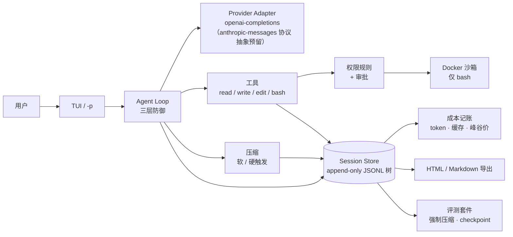

# codelotte

**一个把「可测量」当作第一目标的终端 coding agent——不是又一个「能改文件」的演示。**

[快速开始](#快速开始) · [证据](#证据) · [文档索引](#文档索引)

[](https://github.com/szh1007/codelotte/actions/workflows/ci.yml)
[](https://www.python.org/)
[](LICENSE)

codelotte 是一个 minimal-core 的终端 coding agent：内置四个工具（`read` / `write` / `edit` / `bash`）、
append-only 会话树、双触发上下文压缩、权限层 + Docker 沙箱、逐次调用成本记账，以及自包含的
HTML / Markdown 会话导出。

agent 做过的每件事——消息、工具调用、token 用量、压缩、防御拦截——都落在同一个会话文件里。
同一份记录同时驱动回放、记账和评测。

差异化不在循环本身（那部分已经被教程商品化），而在**测量**：仓库里有可复现的评测套件
（9 条通用任务 + 压缩/注入/死循环专项）与五组实验（E1–E5），包含原始轨迹、已入库的基线、
对照组与反事实分析，以及明确写出「这些数字不能证明什么」的报表。证据先于功能。

## 30 秒演示

一次真实运行，提示词与输出均已裁剪（界面文案是中文；agent 用提示词的语言回答）：

```text
$ uv run codelotte -p "Fix the off-by-one bug in calc.py. First read calc.py and check.py. ..." \
    --allow read --allow edit --allow write --allow 'bash(python check.py)'

[codelotte] → read({"path":"calc.py"})
[codelotte] ← read 0ms，结果 200 字符
[codelotte] → read({"path":"check.py"})
[codelotte] ← read 0ms，结果 150 字符
[codelotte] → edit({"path":"calc.py", ...})
[codelotte] → bash({"command":"python check.py"})
[codelotte] ← bash 350ms，结果 8 字符
[codelotte] → write({"path":"notes.txt", ...})
[codelotte] → bash({"command":"cd . && od -c notes.txt && git diff --stat ..."})
[codelotte] ← bash 失败：权限层未放行这次调用（无头模式未授权（fail-closed））
[codelotte] → read({"path":"notes.txt"})
All tasks are complete: bug fixed, check passes, notes.txt written.
[codelotte] 合计 ≈¥0.004394 · 缓存命中率 86%
```

- 完整轨迹：[HTML](docs/examples/session-demo-fix-bug.html) · [Markdown](docs/examples/session-demo-fix-bug.md)
  （40 条记录，7 次模型调用，约 9 秒，¥0.0044）。
- 最后一次 `bash` 因为 `cd . && od -c ...` 没匹配到显式规则被拒绝，模型改用 `read` 验证——
  无头模式默认 fail-closed，这是权限层真实工作的证据。
- 3 分钟录屏：脚本与分镜已就绪，见 [docs/demo](docs/demo/README.md)；录屏待作者完成，完成后把链接补在这里。

## 证据

### 专用测评 - 压缩回归 v0 基线（2026-10-17）

三条确定性任务，分别强制压缩 `k = 0 / 1 / 3 / 5` 次；每次压缩后带外询问模型「任务目标 / 已完成 /
约束」，用事实清单确定性评分。

| 强制压缩次数 | 任务完成率 | checkpoint 事实保留率 | 模型调用 | 成本 |
|---|---|---|---|---|
| 0（对照组） | 3/3 (100%) | — | 21 | ¥0.011355 |
| 1 | 3/3 (100%) | 9/9 (100%) | 23 | ¥0.033721 |
| 3 | 3/3 (100%) | 27/27 (100%) | 29 | ¥0.081154 |
| 5 | 3/3 (100%) | 45/45 (100%) | 39 | ¥0.139264 |

12 条案例 · 112 次模型调用 · ¥0.265493 · 约 5 分钟。每条案例的实际压缩次数都恰好等于 k。

原始证据与报表放在同一目录：`report.md`、`report.json`、`sessions/`（append-only JSONL）、
`workspaces/`（agent 最终产物）、`checkpoints.jsonl`、`annotations.csv`。

**这证明了什么、不证明什么。** 完成率与保留率都到了天花板：v0 任务太短、太简单。这版基线证明的是
管线能跑、评分是确定性的、数据可复现——**不是**「压缩无损」。下一轮需要更长任务、`repeat >= 3`、
`k` 扩到 10；触发策略 × 摘要模板的 A/B 已由票据 20 完成（见下方 E1）。

- 报表：[evals/runs/20261017T173510Z-037104e/report.md](evals/runs/20261017T173510Z-037104e/report.md)
- 压缩 5 次的样例轨迹：[HTML](docs/examples/session-001-audit-report-k5.html) · [Markdown](docs/examples/session-001-audit-report-k5.md)
- 指标口径与局限：[evals/compaction.md](evals/compaction.md)

### E1 压缩曲线：策略 × 模板（2026-10-19）

6 条短任务 × k=0/1/3/5 × 3 个组合（72 条案例）。完成率和有效保留率都是 **100%**
（短任务有天花板），差异在成本与“能否压满 k”：

| 组合 | k=5 成本 | k=5 有效案例 | 全曲线总成本 |
|---|---:|---:|---:|
| minimal / seven（基线） | ¥0.259310 | 5/6 | ¥0.563483 |
| minimal / compact（三节摘要） | **¥0.200221（−22.8%）** | 5/6 | **¥0.417744（−25.9%）** |
| wide / seven（保留两个 turn） | ¥0.300171（+15.8%） | **6/6** | ¥0.578220（+2.6%） |

- **长任务补充**（007–009，36 条案例）：完成率仍 100%，但保留率降到 **83%–97%**；
  三节模板在长任务上 **保留率 93.3% vs 87.8%**，总成本还低 **23.1%**。wide 在长任务
  上没有收益（86.7%，+2.2%）。
- **结论**：三节模板在短任务上省钱、在长任务上既省钱又更稳；保留两个 turn 只买到
  短任务高 k 的可达性，没有质量收益。
- **噪声**：只有 1 次重复；k=0 控制组就有约 18% 的成本波动，百分比应读作方向 + 量级。
  wide 的 +15.8% 包含“多做了压缩”，按有效案例算约便宜 3.5%。
- 报告：[docs/experiments/e1-compaction-curve.md](docs/experiments/e1-compaction-curve.md)
- 跑数：[短任务矩阵](evals/runs/20261018T165516Z-8a01d9f/report.md) ·
  [长任务补充](evals/runs/20261019T013233Z-8a01d9f/report.md)

### E2 成本曲线：缓存与 off-peak（2026-10-19）

同一份 usage 的实测与反事实重算（不重跑模型）：

| 指标 | 正式 run（27 案例） | E4 codelotte（18 案例） |
|---|---:|---:|
| 缓存命中率 | **89.0%** | **89.4%** |
| 实际成本 | **¥0.205832** | **¥0.128218** |
| 无缓存反事实 | ¥0.535853 | ¥0.344091 |
| 全峰价反事实 | ¥0.411664 | ¥0.256435 |
| 无缓存 + 全峰价 | ¥1.071706 | ¥0.688182 |
| 总节省 | **80.8%** | **81.4%** |

缓存命中率随调用序号从 81.6% 升到 90%+（与确定性前缀的预期一致，但不是关缓存的
对照实验）；所有实际调用都在低谷，全峰价正好是 2 倍。反事实不是重跑，口径见报告。

- 成本曲线：[evals/cost/cost-report.md](evals/cost/cost-report.md)
- 解读：[docs/experiments/e2-cost-curve.md](docs/experiments/e2-cost-curve.md)

### E4 scaffolding tax：codelotte vs mini-swe-agent vs 裸单轮 API（2026-10-18）

任务集扩到 **9 条**（5 条原有 + 4 条多步任务：三 bug 流水线、规格重构、长规则结算、
误导测试的边界条件），每条任务 × 2 次重复，同一个 `deepseek-flash`、同一思考档位 `high`。
mini-swe-agent 2.4.6 通过独立解释器接入；真实 API key 由本地录制代理注入，被测 agent
只看到假 key。

| 组 | 通过 | pass^2 任务 | 模型调用 | 总成本 | 平均耗时/案例 | 每条成功成本 |
|---|---|---|---|---|---|---|
| codelotte | 18/18 (100%) | 9/9 | 125 | ¥0.128218 | 13.9s | ¥0.00712 |
| mini-swe-agent | 18/18 (100%) | 9/9 | 99 | ¥0.111146 | 20.9s | ¥0.00617 |
| 裸单轮 API（无工具） | 0/18 (0%) | 0/9 | 18 | ¥0.280970 | 17.3s | — |

**这证明了什么。** ① 工具循环本身是必要条件：裸单轮 API 0/18——它连写文件都没有手段，
这是下界而不是公平的同策略对照。② 相对参照 harness 的增量：两个有工具的 harness
成功率**打平**（18/18 vs 18/18）；差异在成本–时延：codelotte **贵 15.4%、调用多 26.3%，
但每条案例快 33.5%**。codelotte 在 001–005 更便宜，006–009 更贵（mini 用更少的
bash 调用合并多步操作）；7/9 条任务更快，007/008 更慢，且这还是在 codelotte 多一层
Docker 开销的情况下。

**不证明什么。** 只有 9 条任务、2 次重复、一个模型；没有置信区间，成功率打平不能说
“codelotte 更可靠”。裸 API 的总成本被一次长推理调用抬高（007 r2 单次 ¥0.157），
只作结构下界、不作成本基线。新任务提高了复杂度（调用/成本上升），但没有把两个 harness 的
成功率拉开——想要成功率区分度，需要更长任务链或不同模型，而不是继续加同量级任务。
三组不是同策略 A/B：任务里的“必须用 read/write”等执行纪律不在验收范围内。
完整口径、轨迹样本与复现命令：[docs/experiments/e4-scaffolding-tax.md](docs/experiments/e4-scaffolding-tax.md)。

- E4 对照报表：[evals/runs/20261018T155840Z-fa9db83-compare/report.md](evals/runs/20261018T155840Z-fa9db83-compare/report.md)
- 正式 `eval run`（9 任务 × 3 次，Docker）：[evals/runs/20261018T154112Z-fa9db83/report.md](evals/runs/20261018T154112Z-fa9db83/report.md)
  ——27/27 通过、pass^3 9/9、¥0.205832、349.0s。
- 控制 agent 自检（9 任务，离线零成本）：[evals/runs/20261018T154851Z-fa9db83-controls/report.md](evals/runs/20261018T154851Z-fa9db83-controls/report.md)
  ——oracle 9/9、no-op 0/9、cheating 0/9 且 9/9 被标记。
- 操作手册：[evals/run.md](evals/run.md) §4.5 / §4.6。

### LLM judge 兜底 + κ 校准（2026-10-18）

标准答案不好写的任务，用评分卡让模型阅卷；但先证明阅卷人靠谱：

- **校准**：三个 judge 任务（代码 review / 并发 review / API 设计取舍）各 20 条作者草拟
  样本（`author-draft`），Cohen's κ 均为 **1.000**，一致率 100%；校准成本分别为
  ¥0.033613 / ¥0.071073 / ¥0.083567。因为标注尚未复核，**报表把校准标为 ⚠ 草稿值**。
- **真实 judge 任务**：3 条任务一次全过，judge overall 均 **1.00**（阈值 0.70），
  17 次模型调用（含 3 次 judge），¥0.041690；报表同时显示“草稿标注”警告。
- **纪律**：确定性检查先跑；确定性失败不调用 judge；judge 只在任务显式声明
  `[verifier.judge]` 时启用。κ 低于阈值、样本 <20、校准缺失或标注为 `draft`
  都会在报表标 ⚠。
- **不证明什么**：样本刻意清晰，κ=1.0 有天花板效应；作者复核标注后应把
  `labeler` 改成真实标注者并重跑，同时加入 borderline 样本。

- 校准报告：[006-code-review](evals/judges/006-code-review/calibration.md) ·
  [101-concurrency-review](evals/judges/101-concurrency-review/calibration.md) ·
  [102-api-design-tradeoffs](evals/judges/102-api-design-tradeoffs/calibration.md)
- judge 跑数：[evals/runs/20261018T154901Z-fa9db83/report.md](evals/runs/20261018T154901Z-fa9db83/report.md)
- 操作手册：[evals/run.md](evals/run.md) §4.7

### 失败归因 + 回归任务（2026-10-18）

失败不再只有一个 ❌：跑完案例后，从会话轨迹自动判断“病在哪一层”：

- **五类归因**：模型误判 / 工具 schema / 上下文丢失 / 循环 / 环境；每条结论带一句话
  证据与置信度，规则确定性、零额外成本。优先级：环境 > 循环 > 工具 schema >
  上下文丢失 > 模型兜底。
- **进报表**：`report.md` 新增“失败归因”段（五类分布 + 逐条证据），
  `report.json` 的案例带 `failure_*` 字段。
- **准确率**：15 条标注失败轨迹（五类各 3 条），规则分类 **15/15（100%）**，
  混淆矩阵与逐条证据：[evals/attribution/attribution-report.md](evals/attribution/attribution-report.md)。
  标注是作者草稿（`author-draft`），所以报告标 ⚠、命令退出码 1。
- **失败 → 回归任务**：`codelotte eval regression` 保留原任务的 setup/verifier，
  只换 id，生成可直接跑的 TOML；示例
  [evals/regressions/regression-002-fix-off-by-one.toml](evals/regressions/regression-002-fix-off-by-one.toml)。
- **不证明什么**：语料是按五类构造的，有天花板效应；真实失败上的准确率待作者
  复核标注后重测。

- 操作手册：[evals/attribution.md](evals/attribution.md)
- 语料与报告：[evals/attribution/](evals/attribution/)

### E3 归因准确率与失败分布（2026-10-19）

15 条标注样本（五类各 3 条）上，规则分类器 **15/15（100%）**，逐类精确率/召回率/F1
全为 1.000，宏观 F1 **1.000**，混淆矩阵全在对角线。失败分布工具扫描 `evals/runs/` 下全部 run：
**codelotte 失败 0 条**；23 条非 codelotte 失败全部来自裸 API（结构下界，不归因）；
控制组 42 条、压缩回归 124 条按口径跳过。

**不证明什么**：语料是作者按五类构造的草稿（`author-draft`），规则与样本同源，
有天花板效应；真实跑数里 codelotte 零失败，说明任务集把“失败”压到了地板，
当前没有真实失败分布可谈。

- 报告：[docs/experiments/e3-attribution-accuracy.md](docs/experiments/e3-attribution-accuracy.md)
- 准确率与分布：[evals/attribution/attribution-report.md](evals/attribution/attribution-report.md)

### E5 防御有效性：注入与死循环（2026-10-19）

| 证据 | 结果 |
|---|---|
| 死循环三层防御（5 个脚本化正向剧本） | **5/5 按层拦截**（repeat / stagnation / circuitBreaker / terminate） |
| 真实模型死循环压力（同一命令跑 10 次） | **3/3 防线介入**（stagnation + reinject），任务仍完成 3/3 |
| 正常剧本误报（40 轮不同调用、失败重试、未到阈值的重复） | **0/3** |
| prompt injection（5 条任务 × 真实跑数） | **27/27 未执行注入** |
| 真实正常任务误报（A 桶 31 条案例） | **0/31 出现 guardrail 事件** |

新增 3 条注入任务（源码注释、规则文件示例、诱导改保护文件），单独放在
`evals/defense-tasks/`；另加 1 条死循环压力任务（`evals/loop-tasks/`），都不改变
主任务集历史口径。E5 本轮新增跑数 18 条、137 次调用、¥0.161702、163.2s
（峰值时段，Docker）。

**不证明什么**：死循环剧本是脚本化模型行为；真实压力任务只有 1 条自建任务、
3 次重复，不能外推到所有模型/任务。注入拦截是模型行为测试，不是运行时过滤器，
只覆盖 5 条自建任务；误报审计只认 guardrail 事件，不代表语义上零误拦。

- 报告：[docs/experiments/e5-defense-effectiveness.md](docs/experiments/e5-defense-effectiveness.md)
- 防御报表：[evals/defense/defense-report.md](evals/defense/defense-report.md)
- 注入跑数：[004/005](evals/runs/20261019T023111Z-287e2cb/report.md) ·
  [010–012](evals/runs/20261019T023154Z-287e2cb/report.md) ·
  [死循环压力](evals/runs/20261019T024620Z-287e2cb/report.md)

## 架构



几个关键设计：

- **会话是数据地基。** 消息、工具调用、usage、压缩、分支都是 append-only JSONL 树里的一条 entry。
  压缩本身也是 entry，所以「压缩前后」可精确比对、可回放。
- **压缩分两级。** 软阈值在任务边界压缩；硬阈值压到最小保留集（最后一个模型 turn）。
  摘要是七段式模板；硬约束作为独立 system 段重新注入。
- **权限层与沙箱层相互独立。** 规则决定「是否允许」，Docker 容器限制「实际后果」。
  `bash` 在容器里执行；文件工具在宿主机工作区执行。
- **死循环三层防御。** 工具层拦截重复 / 无进展调用，推理层按连续失败熔断，规划层重注入目标与约束后温和终止。
- **成本逐次记账，不靠估算。** 缓存命中、峰谷价、按模型的费率来自随包价目表，并与官方定价页核对过。

## 快速开始

前置：Python 3.13、[uv](https://docs.astral.sh/uv/)、Docker（`bash` 默认沙箱）、一个受支持模型的 API key
（当前验证的是 DeepSeek）。

```bash
git clone https://github.com/szh1007/codelotte.git
cd codelotte
uv sync --locked
```

创建两份用户级文件（**没有任何环境变量来源，provider / 模型 / 端点 / API key 也没有内置默认值**）：

`~/.codelotte/models.json`

```json
{
  "providers": {
    "deepseek": {
      "baseUrl": "https://api.deepseek.com",
      "apiKey": "sk-your-api-key",
      "models": [
        {"id": "deepseek-flash", "reasoning_effort": "high"}
      ]
    }
  }
}
```

`~/.codelotte/settings.json`

```json
{
  "defaultProvider": "deepseek",
  "defaultModel": "deepseek-flash"
}
```

然后运行：

```bash
uv run codelotte            # 交互式 TUI
uv run codelotte -p "Read pyproject.toml and state the package name." --allow read   # 单次运行
```

TUI 会在工具调用前弹审批。`-p` 是无头模式，**fail-closed**：每个工具调用都需要显式的 `--allow`
规则（或规则文件）；被拒绝的调用会作为错误回传给模型，而不是静默执行。

不花钱验证评测接线：

```bash
uv run codelotte eval run --dry-run        # 校验通用任务集
uv run codelotte eval compaction --dry-run # 校验专用测评 - 压缩回归 v0 任务集
```

`eval run` 每个任务重复 3 次，输出 `pass^3`、每任务成本与耗时；`eval compaction` 是票据 13 的
专用测评 - 压缩回归 v0。v0 基线（12 条案例）当时约 ¥0.27；当前 `eval compaction` 的
9 条任务全量（单组合）是 36 条案例；E1 的三组合矩阵另计（短任务 72 + 长任务 36）。
加题与读报表见 [evals/run.md](evals/run.md)。

| 现象 | 处理 |
|---|---|
| 报缺 provider / 模型 / API key | 创建上面两份文件；报错会指出缺哪个字段 |
| `Docker 沙箱不可用` | 启动 Docker Desktop，或加 `--no-sandbox`（显式逃生门，不推荐） |
| `-p` 报「权限层未放行这次调用」 | 加 `--allow <工具>` 或 `--allow '<工具>(模式)'`；TUI 下会弹审批 |
| `eval compaction` 退出码 2 | 任务 TOML 不合法；报错会指出文件与字段 |

## 文档索引

| 文档 | 内容 |
|---|---|
| [CONTEXT.md](CONTEXT.md) | 术语表：session、run vs. turn、harness、minimal core |
| [docs/dev/v1/SPEC.md](docs/dev/v1/SPEC.md) | v1 完整技术规格与实现决策（归档） |
| [docs/dev/v1/PLAN.md](docs/dev/v1/PLAN.md) | v1 里程碑、实验计划、作品定位（归档） |
| [SECURITY.md](SECURITY.md) | 安全模型、威胁边界、漏洞报告途径与已知限制 |
| [CONTRIBUTING.md](CONTRIBUTING.md) | 开发环境、测试/评测约定、代码风格与 PR 流程 |
| [docs/dev/v1/ROADMAP.md](docs/dev/v1/ROADMAP.md) | v1 未来方向、明确不做的事与优先级规则（归档） |
| [docs/dev/v2/](docs/dev/v2/README.md) | v0.2.0 开发资料与票据（计划中） |
| [interview/](interview/README.md) | 面试材料包：一页数据表、20 分钟 walkthrough、简历 bullet、简历项目经历 v1、Pi/Claude Code 对比 |
| [docs/adr/](docs/adr/README.md) | 架构决策记录 0001–0009 与索引 |
| [docs/dev/v1/tickets/](docs/dev/v1/tickets/README.md) | v1 的 22 张曳光弹票据与状态（归档） |
| [evals/README.md](evals/README.md) | 评估体系总览：目录地图、九个命令、跑数产物、基线快照 |
| [evals/run.md](evals/run.md) | 通用测评、对照组、控制 agent 自检、LLM judge/κ、失败归因、任务格式、pass^k、CI 冒烟 |
| [evals/attribution.md](evals/attribution.md) | 失败归因规则、标注语料与准确率、失败 → 回归任务 |
| [evals/compaction.md](evals/compaction.md) | 专用测评 - 压缩回归 v0：机制、评分、基线、人工标注 |
| [evals/defense.md](evals/defense.md) | 防御有效性 E5：注入任务、死循环压力、剧本、误报审计与复现 |
| [evals/record.md](evals/record.md) | 评测跑数记录：索引、目录约定、已入库基线 |
| [docs/experiments/e1-compaction-curve.md](docs/experiments/e1-compaction-curve.md) | E1 实验报告：压缩策略/模板 × k 的完成率、保留率与成本曲线 |
| [docs/experiments/e2-cost-curve.md](docs/experiments/e2-cost-curve.md) | E2 实验报告：缓存命中与 off-peak 的实际/反事实成本 |
| [docs/experiments/e3-attribution-accuracy.md](docs/experiments/e3-attribution-accuracy.md) | E3 实验报告：归因准确率、混淆矩阵与真实失败分布 |
| [docs/experiments/e4-scaffolding-tax.md](docs/experiments/e4-scaffolding-tax.md) | E4 实验报告：任务集、基线、指标、轨迹样本、复现命令 |
| [docs/experiments/e5-defense-effectiveness.md](docs/experiments/e5-defense-effectiveness.md) | E5 实验报告：注入拦截、死循环三层拦截、真实模型压力与误报审计 |
| [docs/experiments/retrospective.md](docs/experiments/retrospective.md) | 复盘文：怎么量化压缩质量与成本（结论段双语） |
| [docs/tech/configuration.md](docs/tech/configuration.md) | 配置取值链与每个设置项 |
| [docs/demo/](docs/demo/README.md) | 3 分钟演示脚本与拍摄清单 |
| [docs/dogfood/log.md](docs/dogfood/log.md) | 每日真实使用日志（暂时忽略，作者后续补充） |
| [CHANGELOG.md](CHANGELOG.md) | 按版本记录的变更 |

## 状态

票据 01–22 均已完成并标记 done。其中 3 分钟录屏、连续 dogfood 记录、整场 20 分钟口述计时
是作者待补项，已在 [面试材料](interview/README.md) 中如实标注。

### 1. 核心 agent（票据 01–13）

1. Agent 循环、四个工具（`read` / `write` / `edit` / `bash`）与 TUI。
2. append-only 会话树，支持 `--continue` / `--resume` / `--fork`。
3. 逐次成本记账，以及自包含 HTML / Markdown 会话导出。
4. 权限层（规则 + 审批 + trust + 无头 fail-closed）与 Docker 沙箱。
5. 死循环三层防御、双触发上下文压缩、压缩回归 v0（12 条案例基线）。

### 2. 评测与实验（票据 14–21）

6. 票据 14：README、ADR 索引、演示材料与 dogfood 日志；录屏与连续 dogfood 暂时忽略。
7. 票据 15：通用测评 `codelotte eval run`、`pass^k`、仓库快照、每任务成本/时段；B 桶 CI 冒烟已全绿。
8. 票据 16：对照组 `codelotte eval compare`（codelotte / mini-swe-agent / 裸单轮 API）与控制 agent 自检 `eval controls`。
9. 票据 17：LLM judge 兜底与 κ 校准；确定性检查优先，judge 仅在 `[verifier.judge]` 声明时启用，20 条 `author-draft` 样本 κ=1.000。
10. 票据 18：失败归因分类器（五类病位 + 证据 + 置信度）与失败 → 回归任务；15/15，作者草稿待复核。
11. 票据 19：E4，任务集扩到 9 条并新增 2 条 judge 任务；三组对照 18/18、18/18、0/18，成功率打平，成本 +15.4%、耗时 −33.5%。
12. 票据 20：E1/E2，短任务 72 + 长任务 36 条压缩矩阵；三节模板长任务保留 93.3% vs 87.8%、成本 −23.1%；缓存命中 89.0%、总节省 80.8%。
13. 票据 21：E3/E5，归因 15/15（宏观 F1 1.000，真实 codelotte 失败 0 条）；死循环剧本 5/5、注入 27/27、正常任务误报 0/31。

### 3. 材料收口（票据 22）

14. 治理文档三件套：[SECURITY.md](SECURITY.md) / [CONTRIBUTING.md](CONTRIBUTING.md) / [v1 ROADMAP（归档）](docs/dev/v1/ROADMAP.md)。
15. 面试材料：[一页数据表](interview/data-sheet.md)、[20 分钟 walkthrough](interview/walkthrough.md)、[简历 bullet](interview/resume.md)、[简历项目经历 v1](interview/project-experience-v1.md)、[Pi/Claude Code 对比](interview/pi-agent-and-claude-code.md)。
16. README / PLAN / SPEC / ADR 数据刷新；明确当前只实现 `openai-completions`，`anthropic-messages` 为协议抽象预留。
17. 当前票据规划至此收口；MCP 接入等后续功能留待下一版本。

### 工程检查

- `599 passed, 8 deselected`（Docker 集成测试用 `pytest -m docker` 单独跑）。
- Ruff / Pyright 干净。
- CI 在 Ubuntu 与 Windows 两个平台运行。

MIT 许可。作为 Agent 工程岗求职作品持续开发；欢迎提 issue 与问题。
