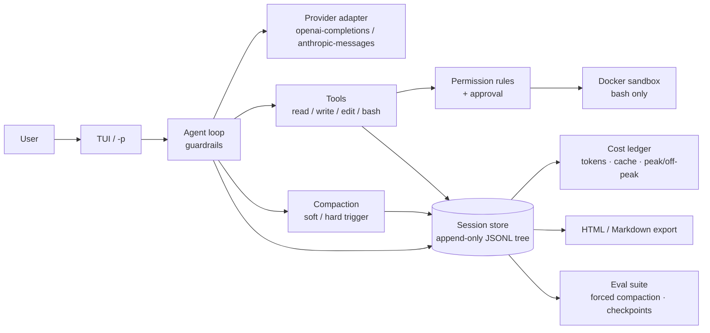

# codelotte

**A terminal coding agent built as a measurable harness — not another "agent that can edit files" demo.**

[中文](README.zh-CN.md) · [Quick start](#quick-start) · [Evidence](#evidence) · [Documentation](#documentation)

[](https://github.com/szh1007/codelotte/actions/workflows/ci.yml)
[](https://www.python.org/)
[](LICENSE)

codelotte is a minimal-core coding agent for the terminal: four built-in tools (`read` / `write` / `edit` / `bash`),
an append-only session tree, dual-trigger context compaction, a permission layer and a Docker sandbox,
per-call cost accounting, and self-contained HTML / Markdown session export.

Everything the agent does — messages, tool calls, token usage, compactions, guardrail events — lands in one
session file. The same record powers replay, billing, and evals.

The differentiator is not the loop; that part is a commodity. It is the **measurement**: the repo ships a
reproducible compaction regression suite with raw trajectories, a checked-in baseline, and a report that says
what the numbers do *not* prove. Evidence first, features second.

## 30-second demo

A real run, prompt and output trimmed (UI strings are Chinese; the agent answers in the language of the prompt):

```text
$ uv run codelotte -p "Fix the off-by-one bug in calc.py. First read calc.py and check.py. ..." \
    --allow read --allow edit --allow write --allow 'bash(python check.py)'

[codelotte] → read({"path":"calc.py"})
[codelotte] ← read 0ms，结果 200 字符
[codelotte] → read({"path":"check.py"})
[codelotte] ← read 0ms，结果 150 字符
[codelotte] → edit({"path":"calc.py", ...})
[codelotte] → bash({"command":"python check.py"})
[codelotte] ← bash 350ms，结果 8 字符
[codelotte] → write({"path":"notes.txt", ...})
[codelotte] → bash({"command":"cd . && od -c notes.txt && git diff --stat ..."})
[codelotte] ← bash 失败：权限层未放行这次调用（无头模式未授权（fail-closed））
[codelotte] → read({"path":"notes.txt"})
All tasks are complete: bug fixed, check passes, notes.txt written.
[codelotte] 合计 ≈¥0.004394 · 缓存命中率 86%
```

- Full trace: [HTML](docs/examples/session-demo-fix-bug.html) · [Markdown](docs/examples/session-demo-fix-bug.md)
  (40 records, 7 model calls, ~9 s, ¥0.0044).
- The last `bash` call was denied because `cd . && od -c ...` did not match the explicit rule; the model
  verified the result with `read` instead. Headless mode is fail-closed by design.
- 3-minute screencast: script and shot list are ready in [docs/demo](docs/demo/README.md); the recording is
  pending and will be linked here.

## Evidence

### Compaction regression, v0 baseline (2026-10-17)

Three deterministic tasks run with **forced** compaction `k = 0 / 1 / 3 / 5`; after every compaction the
model is asked (out of band) what the goal, completed steps, and constraints are, and the answers are scored
against a fact checklist.

| Forced compactions | Task completion | Checkpoint facts retained | Model calls | Cost |
|---|---|---|---|---|
| 0 (control) | 3/3 (100%) | — | 21 | ¥0.011355 |
| 1 | 3/3 (100%) | 9/9 (100%) | 23 | ¥0.033721 |
| 3 | 3/3 (100%) | 27/27 (100%) | 29 | ¥0.081154 |
| 5 | 3/3 (100%) | 45/45 (100%) | 39 | ¥0.139264 |

12 cases · 112 model calls · ¥0.265493 · about 5 minutes. Every case actually compacted exactly `k` times.

Raw evidence is committed next to the report: `report.md`, `report.json`, `sessions/` (append-only JSONL),
`workspaces/` (final agent output), `checkpoints.jsonl`, and `annotations.csv`.

**What this does and does not prove.** Completion and retention both hit the ceiling: the v0 tasks are too
short and too simple. The baseline proves that the pipeline runs, the scoring is deterministic, and the data
is reproducible — not that compaction is lossless. The next experiment needs longer tasks, `repeat >= 3`,
`k` up to 10, and an A/B of trigger policy and summary template (ticket 20).

- Report: [evals/runs/20261017T173510Z-037104e/report.md](evals/runs/20261017T173510Z-037104e/report.md)
- 5-compaction sample trace: [HTML](docs/examples/session-001-audit-report-k5.html) · [Markdown](docs/examples/session-001-audit-report-k5.md)
- Method and scoring caveats: [docs/tech/compaction-regression.md](docs/tech/compaction-regression.md)

## Architecture



Design decisions worth knowing:

- **The session is the substrate.** Every message, tool call, usage record, compaction, and branch is an entry
  in an append-only JSONL tree. Compaction is an entry too, so "before vs after" is diffable and replayable.
- **Compaction is two-level.** A soft threshold compacts at task boundaries; a hard threshold compacts down to
  the smallest retained set (the last model turn). The summary is a seven-section template; hard constraints are
  re-injected as a separate system block.
- **Permissions and sandbox are independent.** Rules decide whether a call may run; the Docker container limits
  what happens if it does. `bash` runs inside the container; file tools run on the host workspace.
- **Loop guardrails are three layers.** Repeated / stagnating calls are blocked at the tool layer, consecutive
  failures trip a circuit breaker, and a planning layer re-injects the goal and constraints before terminating.
- **Cost is per call, not estimated.** Cache hits, peak/off-peak pricing, and per-model rates come from a
  packaged price catalog checked against the provider's page.

## Quick start

Requirements: Python 3.13, [uv](https://docs.astral.sh/uv/), Docker (default sandbox for `bash`), and an API key
for a supported model (DeepSeek is the verified provider).

```bash
git clone https://github.com/szh1007/codelotte.git
cd codelotte
uv sync --locked
```

Create two user-level files (there are **no environment-variable sources and no built-in defaults for the
provider, model, endpoint, or API key**):

`~/.codelotte/models.json`

```json
{
  "providers": {
    "deepseek": {
      "baseUrl": "https://api.deepseek.com",
      "apiKey": "sk-your-api-key",
      "models": [
        {"id": "deepseek-flash", "reasoning_effort": "high"}
      ]
    }
  }
}
```

`~/.codelotte/settings.json`

```json
{
  "defaultProvider": "deepseek",
  "defaultModel": "deepseek-flash"
}
```

Then run:

```bash
uv run codelotte            # interactive TUI
uv run codelotte -p "Read pyproject.toml and state the package name." --allow read   # one-shot
```

The TUI asks for approval on tool calls. `-p` is headless and **fail-closed**: every tool call needs an explicit
`--allow` rule (or a rule file); a denied call is returned to the model as an error, not silently executed.

Verify the evals wiring without spending on model calls:

```bash
uv run codelotte eval compaction --dry-run
```

A full compaction run (12 cases) costs roughly ¥0.27 at the baseline prices. See
[evals/README.md](evals/README.md) for adding tasks and reading reports.

| Symptom | Fix |
|---|---|
| Missing provider / model / API key error | Create the two files above; the error names the missing field |
| `Docker sandbox unavailable` | Start Docker Desktop, or pass `--no-sandbox` (explicit escape hatch, not recommended) |
| `permission layer did not allow this call` in `-p` | Add `--allow <tool>` or `--allow '<tool>(pattern)'`; the TUI would ask instead |
| `eval compaction` exits 2 | A task TOML is invalid; the message names the file and field |

## Documentation

| Document | What it covers |
|---|---|
| [CONTEXT.md](CONTEXT.md) | Glossary: session, run vs. turn, harness, minimal core |
| [SPEC.md](SPEC.md) | Full technical specification and implementation decisions |
| [PLAN.md](PLAN.md) | Milestones, experiments, and portfolio positioning |
| [docs/adr/](docs/adr/README.md) | Architecture decision records 0001–0005, with an index |
| [docs/tickets/](docs/tickets/README.md) | 23 tracer-bullet tickets and their status |
| [evals/README.md](evals/README.md) | How to add tasks, rerun the suite, and read reports |
| [evals/tasks/README.md](evals/tasks/README.md) | Task TOML fields and a copy-paste template |
| [docs/tech/compaction-regression.md](docs/tech/compaction-regression.md) | Compaction metrics, baseline reading, known limits |
| [docs/tech/configuration.md](docs/tech/configuration.md) | Configuration cascade and every setting |
| [docs/demo/](docs/demo/README.md) | 3-minute demo script and recording checklist |
| [docs/dogfood/log.md](docs/dogfood/log.md) | Daily real-task log (from 2026-10-18) |
| [CHANGELOG.md](CHANGELOG.md) | What changed, by version |

## Status

Tickets 01–13 are implemented: loop, four tools, session tree and fork, TUI, cost ledger, HTML export,
permission layer, Docker sandbox, loop guardrails, compaction v1, and the compaction regression suite (the
ticket index notes the few manual-verification items still open). Ticket 14 (this README, ADR index, demo
assets, dogfood log) is in progress; tickets 15–23 cover the general eval runner, baselines, failure
attribution, the E1–E5 experiments, and the final materials pack.

Engineering checks at the time of writing: `454 passed, 8 deselected` (Docker integration tests run with
`pytest -m docker`), Ruff and Pyright clean, CI on Ubuntu and Windows.

MIT licensed. Built as an agent-engineering portfolio project; issues and questions are welcome.
