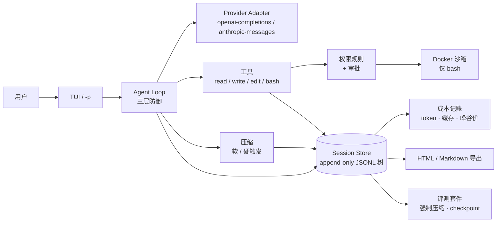

# codelotte

**一个把「可测量」当作第一目标的终端 coding agent——不是又一个「能改文件」的演示。**

[快速开始](#快速开始) · [证据](#证据) · [文档索引](#文档索引)

[](https://github.com/szh1007/codelotte/actions/workflows/ci.yml)
[](https://www.python.org/)
[](LICENSE)

codelotte 是一个 minimal-core 的终端 coding agent：内置四个工具（`read` / `write` / `edit` / `bash`）、
append-only 会话树、双触发上下文压缩、权限层 + Docker 沙箱、逐次调用成本记账，以及自包含的
HTML / Markdown 会话导出。

agent 做过的每件事——消息、工具调用、token 用量、压缩、防御拦截——都落在同一个会话文件里。
同一份记录同时驱动回放、记账和评测。

差异化不在循环本身（那部分已经被教程商品化），而在**测量**：仓库里有一套可复现的
专用测评 - 压缩回归 v0，
包含原始轨迹、已入库的基线，以及一份明确写出「这些数字不能证明什么」的报表。证据先于功能。

## 30 秒演示

一次真实运行，提示词与输出均已裁剪（界面文案是中文；agent 用提示词的语言回答）：

```text
$ uv run codelotte -p "Fix the off-by-one bug in calc.py. First read calc.py and check.py. ..." \
    --allow read --allow edit --allow write --allow 'bash(python check.py)'

[codelotte] → read({"path":"calc.py"})
[codelotte] ← read 0ms，结果 200 字符
[codelotte] → read({"path":"check.py"})
[codelotte] ← read 0ms，结果 150 字符
[codelotte] → edit({"path":"calc.py", ...})
[codelotte] → bash({"command":"python check.py"})
[codelotte] ← bash 350ms，结果 8 字符
[codelotte] → write({"path":"notes.txt", ...})
[codelotte] → bash({"command":"cd . && od -c notes.txt && git diff --stat ..."})
[codelotte] ← bash 失败：权限层未放行这次调用（无头模式未授权（fail-closed））
[codelotte] → read({"path":"notes.txt"})
All tasks are complete: bug fixed, check passes, notes.txt written.
[codelotte] 合计 ≈¥0.004394 · 缓存命中率 86%
```

- 完整轨迹：[HTML](docs/examples/session-demo-fix-bug.html) · [Markdown](docs/examples/session-demo-fix-bug.md)
  （40 条记录，7 次模型调用，约 9 秒，¥0.0044）。
- 最后一次 `bash` 因为 `cd . && od -c ...` 没匹配到显式规则被拒绝，模型改用 `read` 验证——
  无头模式默认 fail-closed，这是权限层真实工作的证据。
- 3 分钟录屏：脚本与分镜已就绪，见 [docs/demo](docs/demo/README.md)；录屏待作者完成，完成后把链接补在这里。

## 证据

### 专用测评 - 压缩回归 v0 基线（2026-10-17）

三条确定性任务，分别强制压缩 `k = 0 / 1 / 3 / 5` 次；每次压缩后带外询问模型「任务目标 / 已完成 /
约束」，用事实清单确定性评分。

| 强制压缩次数 | 任务完成率 | checkpoint 事实保留率 | 模型调用 | 成本 |
|---|---|---|---|---|
| 0（对照组） | 3/3 (100%) | — | 21 | ¥0.011355 |
| 1 | 3/3 (100%) | 9/9 (100%) | 23 | ¥0.033721 |
| 3 | 3/3 (100%) | 27/27 (100%) | 29 | ¥0.081154 |
| 5 | 3/3 (100%) | 45/45 (100%) | 39 | ¥0.139264 |

12 条案例 · 112 次模型调用 · ¥0.265493 · 约 5 分钟。每条案例的实际压缩次数都恰好等于 k。

原始证据与报表放在同一目录：`report.md`、`report.json`、`sessions/`（append-only JSONL）、
`workspaces/`（agent 最终产物）、`checkpoints.jsonl`、`annotations.csv`。

**这证明了什么、不证明什么。** 完成率与保留率都到了天花板：v0 任务太短、太简单。这版基线证明的是
管线能跑、评分是确定性的、数据可复现——**不是**「压缩无损」。下一轮需要更长任务、`repeat >= 3`、
`k` 扩到 10，并做触发策略 × 摘要模板的 A/B（票据 20）。

- 报表：[evals/runs/20261017T173510Z-037104e/report.md](evals/runs/20261017T173510Z-037104e/report.md)
- 压缩 5 次的样例轨迹：[HTML](docs/examples/session-001-audit-report-k5.html) · [Markdown](docs/examples/session-001-audit-report-k5.md)
- 指标口径与局限：[evals/compaction.md](evals/compaction.md)

## 架构



几个关键设计：

- **会话是数据地基。** 消息、工具调用、usage、压缩、分支都是 append-only JSONL 树里的一条 entry。
  压缩本身也是 entry，所以「压缩前后」可精确比对、可回放。
- **压缩分两级。** 软阈值在任务边界压缩；硬阈值压到最小保留集（最后一个模型 turn）。
  摘要是七段式模板；硬约束作为独立 system 段重新注入。
- **权限层与沙箱层相互独立。** 规则决定「是否允许」，Docker 容器限制「实际后果」。
  `bash` 在容器里执行；文件工具在宿主机工作区执行。
- **死循环三层防御。** 工具层拦截重复 / 无进展调用，推理层按连续失败熔断，规划层重注入目标与约束后温和终止。
- **成本逐次记账，不靠估算。** 缓存命中、峰谷价、按模型的费率来自随包价目表，并与官方定价页核对过。

## 快速开始

前置：Python 3.13、[uv](https://docs.astral.sh/uv/)、Docker（`bash` 默认沙箱）、一个受支持模型的 API key
（当前验证的是 DeepSeek）。

```bash
git clone https://github.com/szh1007/codelotte.git
cd codelotte
uv sync --locked
```

创建两份用户级文件（**没有任何环境变量来源，provider / 模型 / 端点 / API key 也没有内置默认值**）：

`~/.codelotte/models.json`

```json
{
  "providers": {
    "deepseek": {
      "baseUrl": "https://api.deepseek.com",
      "apiKey": "sk-your-api-key",
      "models": [
        {"id": "deepseek-flash", "reasoning_effort": "high"}
      ]
    }
  }
}
```

`~/.codelotte/settings.json`

```json
{
  "defaultProvider": "deepseek",
  "defaultModel": "deepseek-flash"
}
```

然后运行：

```bash
uv run codelotte            # 交互式 TUI
uv run codelotte -p "Read pyproject.toml and state the package name." --allow read   # 单次运行
```

TUI 会在工具调用前弹审批。`-p` 是无头模式，**fail-closed**：每个工具调用都需要显式的 `--allow`
规则（或规则文件）；被拒绝的调用会作为错误回传给模型，而不是静默执行。

不花钱验证评测接线：

```bash
uv run codelotte eval run --dry-run        # 校验通用任务集
uv run codelotte eval compaction --dry-run # 校验专用测评 - 压缩回归 v0 任务集
```

`eval run` 每个任务重复 3 次，输出 `pass^3`、每任务成本与耗时；`eval compaction` 是票据 13 的
专用测评 - 压缩回归 v0。v0 基线（12 条案例）当时约 ¥0.27；当前 5 条任务的压缩全量是
20 条案例。加题与读报表见 [evals/run.md](evals/run.md)。

| 现象 | 处理 |
|---|---|
| 报缺 provider / 模型 / API key | 创建上面两份文件；报错会指出缺哪个字段 |
| `Docker 沙箱不可用` | 启动 Docker Desktop，或加 `--no-sandbox`（显式逃生门，不推荐） |
| `-p` 报「权限层未放行这次调用」 | 加 `--allow <工具>` 或 `--allow '<工具>(模式)'`；TUI 下会弹审批 |
| `eval compaction` 退出码 2 | 任务 TOML 不合法；报错会指出文件与字段 |

## 文档索引

| 文档 | 内容 |
|---|---|
| [CONTEXT.md](CONTEXT.md) | 术语表：session、run vs. turn、harness、minimal core |
| [SPEC.md](SPEC.md) | 完整技术规格与实现决策 |
| [PLAN.md](PLAN.md) | 里程碑、实验计划、作品定位 |
| [docs/adr/](docs/adr/README.md) | 架构决策记录 0001–0005 与索引 |
| [docs/tickets/](docs/tickets/README.md) | 23 张曳光弹票据与状态 |
| [evals/run.md](evals/run.md) | 通用测评：两个命令、任务格式、pass^k、CI 冒烟 |
| [evals/compaction.md](evals/compaction.md) | 专用测评 - 压缩回归 v0：机制、评分、基线、人工标注 |
| [evals/record.md](evals/record.md) | 评测跑数记录：索引、目录约定、已入库基线 |
| [docs/tech/configuration.md](docs/tech/configuration.md) | 配置取值链与每个设置项 |
| [docs/demo/](docs/demo/README.md) | 3 分钟演示脚本与拍摄清单 |
| [docs/dogfood/log.md](docs/dogfood/log.md) | 每日真实使用日志（暂时忽略，作者后续补充） |
| [CHANGELOG.md](CHANGELOG.md) | 按版本记录的变更 |

## 状态

票据 01–13 已实现：循环、四个工具、会话树与 fork、TUI、成本记账、HTML 导出、权限层、Docker 沙箱、
死循环三层防御、压缩 v1、专用测评 - 压缩回归 v0（个别真机验证备注见票据索引）。票据 14、15 已完成：
票据 14 交付 README、ADR 索引、演示材料与 dogfood 日志（3 分钟录屏与连续 dogfood 暂时忽略，
作者后续补充）；票据 15 交付通用测评（`codelotte eval run`、`pass^k`、仓库快照、每任务成本/时段）
与 B 桶 CI 冒烟，CI 已全绿。票据 16–23 覆盖对照组、失败归因、E1–E5 实验与最终材料包。

当前工作树的工程检查：`476 passed, 8 deselected`（Docker 集成测试用 `pytest -m docker` 单独跑）、
Ruff / Pyright 干净、CI 在 Ubuntu 与 Windows 两个平台运行。

MIT 许可。作为 Agent 工程岗求职作品持续开发；欢迎提 issue 与问题。
